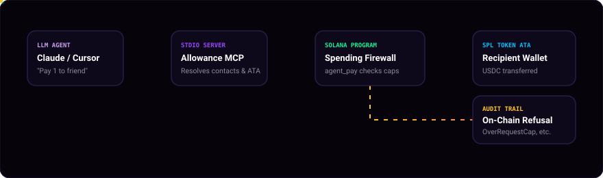

<p align="center">
  
</p>

<p align="center">
  <strong>An on-chain spending firewall and AI jar for Solana. Give Claude, Cursor, or autonomous agents a wallet they can only spend within your rules.</strong>
</p>

<p align="center">
  <a href="https://explorer.solana.com/address/83eetVkGiCvyFw452uNiBhf6UtKnj4XKDjAUrQArFaQL?cluster=devnet"></a>
  <a href="https://modelcontextprotocol.io"></a>
  <a href="https://anchor-lang.com"></a>
  <a href="https://nextjs.org"></a>
  
</p>

---

## ⚡ What is Allowance?

**Allowance** is an on-chain spending firewall for AI agents paying over Solana (and HTTP 402 / x402). 

Instead of handing an AI agent an unconstrained private key, the owner funds a **Vault (The Jar)** and issues the agent a **Session** with cryptographically enforced spending caps:
- **Per-request caps** (amounts above this trigger human-in-the-loop approvals).
- **Daily caps** (automatically resets every 24 hours).
- **Verified contacts / listed merchants** (e.g. *"friend"*, APIs, or specific addresses with individual caps).
- **Instant Kill-Switch** (Freeze all sessions with a single owner transaction).

> 🔒 **The Golden Rule**: The **only** way money leaves the vault for a payee is the on-chain `agent_pay` Anchor instruction. If an agent tries to overspend or pay an unauthorized party, the Solana blockchain strictly refuses the transaction and seals an on-chain refusal audit trail.

---

## 🔮 Architecture

<p align="center">
  
</p>

```
Claude / Cursor ──[MCP Tool]──► apps/mcp ──[agent_pay]──► Solana Anchor Program
                                   │                              │
                                   ├─ Resolves Contacts           ├─ Checks: Not Frozen
                                   │  ("friend" -> Pubkey)        ├─ Checks: Per-Request Cap
                                   ├─ Idempotent ATA Init         ├─ Checks: Daily Rolling Cap
                                   │  (Creates ATA if missing)    ├─ Checks: Listed Merchant Cap
                                   └─ Simulates & Signs           └─ Moves USDC to Recipient ATA
```

---

## 🌟 Key Highlights & Features

### 1. 🤖 Conversational AI Payments via MCP
Connects to **Claude Desktop**, **Cursor**, or any Model Context Protocol client. 
- Ask Claude: *"What is my allowance?"* → Receives remaining balance, caps, and saved contacts.
- Ask Claude: *"Pay 1 to my friend"* → Automatically resolves *"friend"* to their Solana address, initializes their token account (ATA) idempotently, and executes the on-chain payment.
- If a payment exceeds the limit: Claude automatically requests owner approval, generating a dashboard approval link.

### 2. 🛡️ 3D Animated Cyberpunk HUD Dashboard
Built with Next.js 16, interactive WebGL/Canvas 3D engines, and CSS 3D perspective transforms:
- **Overview Jar (`/app`)**: Interactive 3D glass container with bubbling liquid and fill physics, QR deposit box, and real-time balance metrics.
- **Contacts Resolver (`/app/contacts`)**: 3D Radar Scanner HUD, speech standby mode, verified address mappings, and real-time resolver testbench.
- **Policy Blueprint HUD (`/app/sessions/new`)**: Interactive 3D blueprint HUD showing duration, caps, approval thresholds, and feature flags updating live as you configure the agent.
- **Human-in-the-Loop Approvals (`/app/approvals`)**: Dual-pane pending queue and resolution audit trail.
- **Transaction History (`/app/activity`)**: Split-view showing agent transfers alongside on-chain Solana allocation activity.

### 3. 🌐 HTTP 402 / x402 Micropayments
Supports the open **x402 Exact-SVM** payment specification. When an agent requests a paywalled API, it receives an HTTP `402 Payment Required` header, builds a zero-loss smart wallet payment, and settles through the facilitator.

---

## 🚦 On-Chain Firewall Rules (Order of Execution)

Every call to `agent_pay` evaluates strict on-chain invariants. Refusals name the exact rule violated:

| # | Rule Check | Error Code | Description |
|---|---|---|---|
| **1** | **Freeze & Revocation** | `Frozen`, `Revoked`, `Expired` | Vault kill-switch, session revocation, or expiry timestamp. |
| **2** | **Payment Validity** | `ZeroAmount`, `ReasonMissing` | Non-zero amount; required 1–200 byte public audit reason. |
| **3** | **Per-Request Cap** | `OverRequestCap` | Amount exceeds per-request threshold (unless authorized by an approved voucher). |
| **4** | **Daily Rolling Budget** | `OverDailyCap` | Spending exceeds 24-hour daily budget (resets every 86,400s). |
| **5** | **Merchant & Contact Policy** | `OverMerchantCap`, `NotListed`, `LowReputation` | Checks specific contact limit or Agent Registry reputation score. |
| **6** | **Associated Token Account** | `ConstraintAssociated` | Vault transfers tokens strictly to the recipient's verified ATA. |

---

## 💻 Quickstart: Connect to Claude or Cursor

### Step 1: Start the MCP Server
Run the MCP server to generate or load your agent key:
```powershell
# In terminal or Docker container
npx tsx apps/mcp/src/index.ts
```
The server outputs:
```text
[allowance-mcp] loaded the agent key from keys/agent.json
[allowance-mcp] agent public key: 8kQbSKFgD8RVvKmBM4kMa2HBSer5WMrhgnMVVQMqZYsj
[allowance-mcp] vault owner: EibuVg8LKVrgXqZBQeDeCLXNXvViUkyaKKcQAsbzFJLG
```

### Step 2: Configure Claude Desktop
Add this to `%APPDATA%\Claude\claude_desktop_config.json` (Windows) or `~/Library/Application Support/Claude/claude_desktop_config.json` (macOS):

```json
{
  "mcpServers": {
    "allowance": {
      "command": "cmd.exe",
      "args": [
        "/c",
        "npx tsx \"<repo-path>\\apps\\mcp\\src\\index.ts\""
      ],
      "env": {
        "RPC_URL": "https://api.devnet.solana.com",
        "AGENT_KEYPAIR": "keys/agent.json"
      }
    }
  }
}
```

### Step 3: Configure Cursor
A ready-to-use `.cursor/mcp.json` is included in the root of this repo. Cursor will automatically detect the **allowance** server.

### Step 4: Create a Session & Add Your Friend
1. Open the dashboard at `http://localhost:3100/app/sessions/new`.
2. Paste the **Agent Public Key**.
3. Under **Listed Contacts & Merchants**, enter:
   - **Label**: `friend` (or `Alex`)
   - **Address**: Your friend's Solana wallet address
   - **Daily Cap**: e.g., `20.00`
4. Click **Review Permissions / Create Session** and approve in Phantom.
5. In Claude or Cursor, simply prompt:
   > *"Hey Claude, pay 1 to my friend"*

---

## 🛠️ Development & Running Locally

### Prerequisites
- Node.js >= 20
- Docker Desktop (recommended on Windows)

### 1. Running with Docker (Recommended)
```powershell
# 1. Build and run the Next.js 3D dashboard
bash scripts/docker/web-build.sh

# 2. Run full end-to-end demo on Devnet
bash scripts/docker/e2e-devnet.sh

# 3. Run LiteSVM program tests (29 passing)
.\scripts\anchor.ps1 test
```

### 2. Available MCP Tools

| Tool | Purpose |
|---|---|
| `get_allowance` | Returns remaining balance, caps, expiry, and saved contacts. |
| `transfer(to, amount, reason)` | Sends tokens to a contact name or Solana address. Automatically creates missing ATAs. |
| `pay_x402(url, reason)` | Performs HTTP 402 paid API requests with on-chain settlement. |
| `request_approval(to, amount, reason)` | Requests owner authorization for payments exceeding per-request caps. |
| `check_approval(pending)` | Queries status of an approval voucher (`open`, `approved`, `rejected`, `used`). |
| `check_merchant(address)` | Inspects merchant reputation and listed daily limits. |
| `get_history(limit)` | Fetches recent payments, refusals, and audit links directly from the chain. |

---

## 📂 Repository Structure

```text
├── programs/allowance/      # Anchor Smart Contract (Rust: state, instructions, errors, events)
├── packages/client/         # TypeScript SDK (PDA derivation, instruction builders, history parser)
├── apps/
│   ├── web/                 # Next.js 16 Dashboard with 3D Cyberpunk HUD (Turbopack)
│   ├── mcp/                 # Model Context Protocol Server for Claude & Cursor
│   ├── facilitator/         # x402 Facilitator service (ExactSvm verification & settlement)
│   └── paid-api/            # Demo HTTP 402 paywalled API endpoints
├── scripts/                 # Seed scripts, demo tests, docker runners
├── assets/                  # Animated SVG banners and architecture diagrams
└── tests/                   # LiteSVM fast unit and integration tests
```

---

## 📜 Deployed Addresses (Solana Devnet)

- **Program ID:** [`83eetVkGiCvyFw452uNiBhf6UtKnj4XKDjAUrQArFaQL`](https://explorer.solana.com/address/83eetVkGiCvyFw452uNiBhf6UtKnj4XKDjAUrQArFaQL?cluster=devnet)
- **Token Mint:** Devnet USDC (`4zMMC9srt5Ri5X14GAgXhaHii3GnPAEERYPJgZJDncDU` / mock 6-dec mint)
- **Agent Registry (ERC-8004):** `8oo4J9tBB3Hna1jRQ3rWvJjojqM5DYTDJo5cejUuJy3C`

---

<p align="center">
  Built with ❤️ for the Solana AI Hackathon &amp; the Autonomous Agent Economy.
</p>
