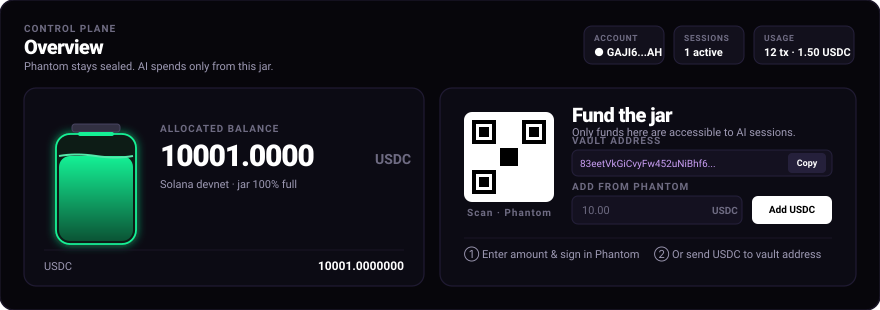
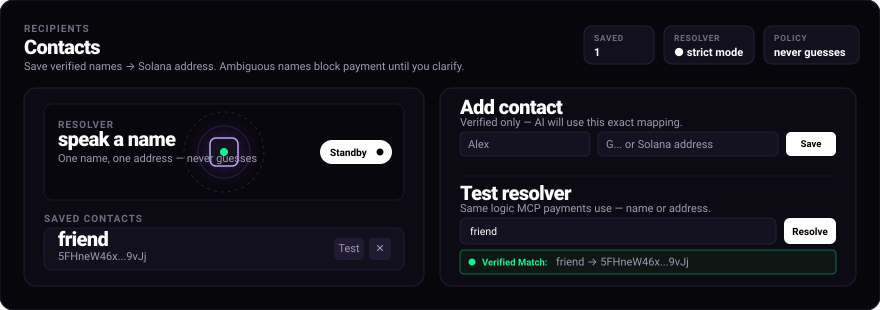
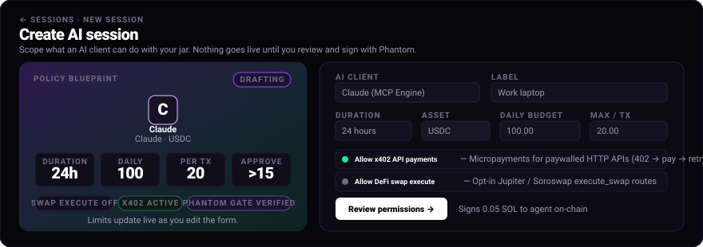
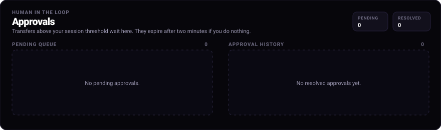
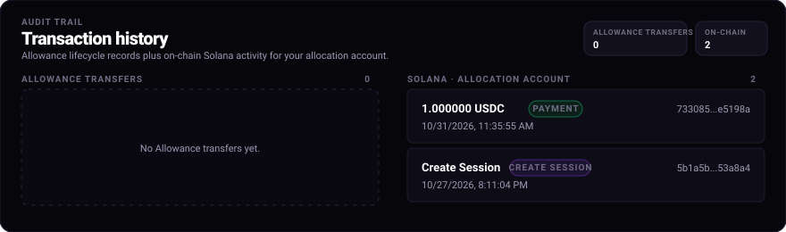

<p align="center">
  
</p>

<p align="center">
  <strong>An on-chain spending firewall and AI jar for Solana. Give Claude, Cursor, or autonomous agents a wallet they can only spend within your rules.</strong>
</p>

<p align="center">
  <a href="https://explorer.solana.com/address/83eetVkGiCvyFw452uNiBhf6UtKnj4XKDjAUrQArFaQL?cluster=devnet"></a>
  <a href="https://modelcontextprotocol.io"></a>
  <a href="https://anchor-lang.com"></a>
  <a href="https://nextjs.org"></a>
  
</p>

---

## 📑 Table of Contents

- [The Problem & Threat Model](#-the-problem--threat-model)
- [What is Allowance?](#-what-is-allowance)
- [🎬 Product Demo & Walkthrough Video](#-product-demo--walkthrough-video)
- [🔮 Architecture & System Design](#-architecture--system-design)
- [🖥️ Minimalist Cyberpunk HUD Walkthrough](#-minimalist-cyberpunk-hud-walkthrough)
  - [1. Control Plane & 3D Jar (`/app`)](#1-control-plane--3d-jar-app)
  - [2. Recipients & 3D Radar Resolver (`/app/contacts`)](#2-recipients--3d-radar-resolver-appcontacts)
  - [3. Policy Blueprint HUD (`/app/sessions/new`)](#3-policy-blueprint-hud-appsessionsnew)
  - [4. Human-In-The-Loop Approvals (`/app/approvals`)](#4-human-in-the-loop-approvals-appapprovals)
  - [5. Transaction History & Audit Trail (`/app/activity`)](#5-transaction-history--audit-trail-appactivity)
- [🤖 Model Context Protocol (MCP) Integration](#-model-context-protocol-mcp-integration)
  - [Available MCP Tools](#available-mcp-tools)
  - [Connecting to Claude Desktop](#connecting-to-claude-desktop)
  - [Connecting to Cursor IDE](#connecting-to-cursor-ide)
- [🌐 HTTP 402 / x402 Micropayments](#-http-402--x402-micropayments)
- [🚦 On-Chain Firewall Rules & Invariants](#-on-chain-firewall-rules--invariants)
- [⚙️ Solana Program Accounts (PDA Schema)](#-solana-program-accounts-pda-schema)
- [🛠️ Local Development & LiteSVM Testing](#-local-development--litesvm-testing)
- [📂 Repository Structure](#-repository-structure)
- [📜 Deployed Addresses (Solana Devnet)](#-deployed-addresses-solana-devnet)

---

## 🚨 The Problem & Threat Model

Autonomous AI agents (powered by Claude, GPT-4, Llama 3, or Cursor) are rapidly transitioning from conversational advisors to autonomous economic actors. However, giving an AI direct access to financial keys is catastrophic:

```
❌ Traditional Approach: Direct Key Sharing
┌─────────────────┐       Raw Private Key       ┌────────────────────────┐
│  AI Agent / LLM │ ──────────────────────────► │  Main Phantom Wallet   │  ===> TOTAL DRAIN
└─────────────────┘                             │  (Unconstrained Funds) │       (Prompt Injection / Bugs)
                                                └────────────────────────┘

✅ Allowance Approach: On-Chain Spending Firewall
┌─────────────────┐    Restricted Agent Key     ┌────────────────────────┐       Only Allowed Under Rules
│  AI Agent / LLM │ ──────────────────────────► │ Solana Program PDA     │ ──────────────────────────────► Recipient
└─────────────────┘                             │ (Vault + Session Caps) │
                                                └────────────────────────┘
                                                            ▲
                                            Owner Signs Only to Fund or Override
```

1. **Prompt Injection & Social Engineering**: An agent browsing untrusted web pages or parsing user input can be hijacked into transferring the wallet's entire balance.
2. **Infinite Loops & Flawed Automation**: A hallucinating agent in an execution loop can drain hundreds of dollars in seconds via recursive transactions.
3. **No Granular Scoping**: Standard crypto wallets have no concept of "spend max $5/day" or "only pay contacts named Alex". Either the agent has full access, or none.
4. **Off-Chain Guardrails Are Fragile**: Client-side checks in Python/TypeScript can easily be bypassed, crashed, or misconfigured. 

**Allowance shifts the boundary to the blockchain.** The Solana program enforces hard spending rules at the virtual machine layer: if an agent violates even one constraint, the transaction fails and produces an immutable on-chain audit refusal.

---

## ⚡ What is Allowance?

**Allowance** is an on-chain spending firewall and dedicated AI Jar built specifically for Solana:

- 🏺 **The AI Jar (`Vault` PDA)**: The owner deposits an allocated budget (e.g. 50 USDC). The agent never touches the owner's personal Phantom wallet or main savings.
- 📜 **Scoped AI Sessions (`Session` PDA)**: The owner creates a cryptographic session for an agent public key, locking down:
  - **Per-request maximums** (e.g. transfers over 5 USDC require human approval).
  - **Daily rolling limits** (e.g. max 20 USDC spent per 24-hour window, automatically resetting).
  - **Contact whitelists & listed merchant caps** (e.g. "friend", "OpenAI API", with individual allowances).
  - **Expiry timestamps** (sessions automatically become invalid after a set duration).
- 🤝 **Human-in-the-Loop (`PendingVoucher` PDA)**: When an agent needs to make an unusual or high-value payment, it issues an on-chain voucher that the owner can approve with 1-click in the dashboard.
- 🛑 **Owner Kill-Switch**: The owner can instantly pause the vault or revoke any session on-chain with a single transaction.

---

## 🎬 Product Demo & Walkthrough Video

<div align="center">
  <video src="https://raw.githubusercontent.com/manasshete/allowance-solana/main/docs/allowance-how-to-use.mp4" controls="controls" width="100%" style="max-width: 860px; border-radius: 14px; box-shadow: 0 18px 45px rgba(0,0,0,0.8); border: 1px solid #201b33;">
    <p>Your browser does not support the video tag. <a href="./docs/allowance-how-to-use.mp4"><strong>Click here to download or watch the demo video directly (docs/allowance-how-to-use.mp4)</strong></a>.</p>
  </video>
  <br />
  <p>
    <em>Full walkthrough: funding the AI jar, setting session rules, resolving contacts with the 3D Radar, and autonomous conversational payments using Claude via MCP.</em>
    <br />
    <sub>📝 English subtitles included in <a href="./docs/allowance-how-to-use.srt"><code>docs/allowance-how-to-use.srt</code></a></sub>
  </p>
</div>

---

## 🔮 Architecture & System Design

<p align="center">
  
</p>

### End-to-End Execution Lifecycle

```
 User Prompt: "Hey Claude, pay 1 to my friend"
      │
      ▼
┌──────────────┐
│ Claude / LLM │  Analyzes intent and executes `transfer(to: "friend", amount: 1)`
└──────┬───────┘
       │ MCP Protocol (JSON-RPC stdio)
       ▼
┌──────────────────┐
│  Allowance MCP   │  1. Scans session contacts -> maps "friend" to Solana Pubkey
│ (apps/mcp)       │  2. Checks recipient Token Account (ATA) -> creates ATA idempotently if missing
└──────┬───────────┘  3. Builds Anchor `agent_pay` instruction & signs with agent keypair
       │ RPC (Solana Devnet)
       ▼
┌────────────────────────────────────────────────────────┐
│  Allowance Smart Contract (Solana Anchor Program)      │
│                                                        │
│  [Check 1]  Vault not frozen & Session not revoked?   │
│  [Check 2]  Amount <= Per-Request Cap?                 │
│  [Check 3]  Rolling 24h Spend + Amount <= Daily Cap?   │
│  [Check 4]  Recipient is Listed Merchant / Contact?    │
│  [Check 5]  Valid SPL Token Associated Account?        │
└──────┬─────────────────────────────────────────────────┘
       │
       ├─────────────────────────────────┐
       ▼ (PASS)                          ▼ (VIOLATION)
┌─────────────────────────────┐   ┌─────────────────────────────┐
│ Token Transfer Executed     │   │ Transaction Reverted        │
│ Tokens moved to friend ATA  │   │ Logs on-chain Refusal Event │
│ Session metrics updated     │   │ (e.g. OverDailyCap)         │
└─────────────────────────────┘   └─────────────────────────────┘
```

---

## 🖥️ Minimalist Cyberpunk HUD Walkthrough

The Allowance dashboard is crafted as a high-fidelity cyberpunk control plane built with **Next.js 16**, **CSS 3D perspective transforms**, **WebGL/Canvas 3D engines**, and **Tailwind CSS**.

---

### 1. Control Plane & 3D Jar (`/app`)

<p align="center">
  
</p>

- **Interactive 3D Glass Jar**: Renders a dynamic, liquid-filled 3D vessel that visually reflects your allocated balance, capacity, and real-time fill level with fluid particles.
- **Dedicated Allocation Address**: Phantom wallet stays completely sealed; agents only draw funds from this isolated PDA address.
- **Quick-Funding Suite**: Scan the QR code with mobile Phantom or copy the deposit address with 1 click.
- **Real-Time Telemetry**: Live metrics for total active sessions, cumulative transaction count, and daily volume spent.

---

### 2. Recipients & 3D Radar Resolver (`/app/contacts`)

<p align="center">
  
</p>

- **3D Radar Scanner HUD**: An interactive radar screen featuring a sweeping beam, concentric range rings, and floating target blips.
- **Strict Resolution Policy**: Eliminates ambiguity. If Claude is told *"pay 1 to my friend"*, the system strictly matches the verified contact entry and never guesses or hallucinates an address.
- **Speech Standby HUD**: Visual audio-mode toggle indicating voice-payment readiness.
- **Resolver Testbench**: Live sandbox input to test recipient resolution directly in the browser before invoking agent commands.

---

### 3. Policy Blueprint HUD (`/app/sessions/new`)

<p align="center">
  
</p>

- **Real-Time Isometric Blueprint**: A live-updating HUD card that visually reflects your session parameters (agent avatar, duration, daily budget, per-tx cap, approval triggers) as you type.
- **Per-Transaction & Daily Guardrails**: Hard numerical caps that prevent runaway agents.
- **Approval Thresholds**: Configure the exact threshold above which payments must pause and wait for owner review.
- **Granular Permissions & Feature Flags**:
  - `Allow DeFi swap execute`: Opt-in permission for autonomous token swaps.
  - `Allow x402 API payments`: Opt-in micropayments for paywalled HTTP APIs.

---

### 4. Human-In-The-Loop Approvals (`/app/approvals`)

<p align="center">
  
</p>

- **Pending Voucher Queue**: Payments requested by the AI agent exceeding the session's per-transaction threshold are paused and held here.
- **2-Minute Auto-Expiry**: Vouchers automatically self-expire on-chain if left unreviewed, preventing stale execution attacks.
- **1-Click Phantom Authorization**: Owners can review the payee, requested amount, and agent reason, approving or rejecting with a single wallet signature.
- **Approval History Ledger**: Full audit trail of approved, rejected, and expired vouchers.

---

### 5. Transaction History & Audit Trail (`/app/activity`)

<p align="center">
  
</p>

- **Dual-Column Audit Ledger**: Side-by-side presentation separating high-level Allowance agent transfers from low-level on-chain Solana allocation events.
- **On-Chain Refusal Logging**: Every blocked or refused transaction records the precise reason and error code on-chain.
- **Explorer Deep-Links**: Direct 1-click links to Solana Devnet Explorer for every transaction signature.

---

## 🤖 Model Context Protocol (MCP) Integration

The **Allowance MCP Server** (`apps/mcp`) implements Anthropic's Model Context Protocol over `stdio`. It turns Claude Desktop or Cursor into an autonomous financial agent that operates strictly within your on-chain firewall.

### Conversational Examples

- 💬 *"Hey Claude, what is my allowance?"*
  > *"You have 10.00 USDC available today (daily budget: 20.00 USDC). Your per-transaction cap is 5.00 USDC. Saved contacts: Alex (`GAJI6...AH`), API Provider (`9kW1...3Z`)."*

- 💬 *"Hey Claude, pay 1 to my friend for lunch"*
  > *"Resolved 'friend' to `GAJI6PHTD03QPZZK...`. Recipient ATA verified and created. Sent 1.00 USDC on Solana Devnet. Tx: `3xK7...9qPz`."*

- 💬 *"Pay 25 to Alex"*
  > *"Amount 25.00 USDC exceeds your per-request cap of 5.00 USDC. I have created Pending Approval Voucher #14. Please approve it in your Allowance dashboard at http://localhost:3100/app/approvals."*

---

### Available MCP Tools

| Tool | Parameters | Description |
|---|---|---|
| `get_allowance` | None | Returns the current session status, remaining daily budget, per-request cap, expiry, and all saved contacts. |
| `transfer` | `to` (string), `amount` (number), `reason` (string) | Executes an on-chain payment. Resolves names against contacts and creates recipient ATAs idempotently. |
| `pay_x402` | `url` (string), `reason` (string) | Handles HTTP 402 paywalled endpoints, signs Exact-SVM settlement, and returns the paid resource. |
| `request_approval` | `to` (string), `amount` (number), `reason` (string) | Creates an on-chain `PendingVoucher` for transfers exceeding per-request caps. |
| `check_approval` | `pending` (string / number) | Polls the on-chain status of a pending voucher (`open`, `approved`, `rejected`, `used`). |
| `check_merchant` | `address` (string) | Inspects a recipient's reputation score and listed merchant daily limits. |
| `get_history` | `limit` (number, optional) | Retrieves recent on-chain transfers, refusals, and audit transaction hashes. |

---

### Connecting to Claude Desktop

Add this configuration to your Claude Desktop config file:
- **Windows**: `%APPDATA%\Claude\claude_desktop_config.json`
- **macOS**: `~/Library/Application Support/Claude/claude_desktop_config.json`

```json
{
  "mcpServers": {
    "allowance": {
      "command": "cmd.exe",
      "args": [
        "/c",
        "npx tsx \"L:\\5th semister\\allowance solana\\apps\\mcp\\src\\index.ts\""
      ],
      "env": {
        "RPC_URL": "https://api.devnet.solana.com",
        "AGENT_KEYPAIR": "keys/agent.json"
      }
    }
  }
}
```

---

### Connecting to Cursor IDE

A pre-configured [`.cursor/mcp.json`](file:///.cursor/mcp.json) is included in the project root:

```json
{
  "mcpServers": {
    "allowance": {
      "command": "node",
      "args": ["-r", "ts-node/register", "apps/mcp/src/index.ts"],
      "env": {
        "RPC_URL": "https://api.devnet.solana.com",
        "AGENT_KEYPAIR": "keys/agent.json"
      }
    }
  }
}
```
Open Cursor settings under **Features → MCP Servers** to verify the server shows a green indicator.

---

## 🌐 HTTP 402 / x402 Micropayments

Allowance natively integrates the **x402 Exact-SVM** micropayment standard (`@x402/svm`). This allows autonomous agents to consume paywalled APIs seamlessly:

```
Agent Request ──► Paywalled API (apps/paid-api)
                     │
                     ├─ Responds: HTTP 402 Payment Required
                     │  Header: X-402-Payment-Required: { facilitator, amount: 0.05, mint }
                     ▼
Allowance MCP ──► Evaluates on-chain session budget
                     │
                     ├─ Calls `agent_pay` targeting the Facilitator PDA
                     ├─ Re-submits request with `X-402-Authorization: <tx-signature>`
                     ▼
Facilitator   ──► Verifies on-chain settlement & unlocks HTTP 200 data stream
```

---

## 🚦 On-Chain Firewall Rules & Invariants

Every call to the `agent_pay` Anchor instruction runs through a deterministic battery of on-chain invariant checks:

| # | Invariant Rule | Anchor Error | Description |
|---|---|---|---|
| **1** | **Vault Active Check** | `Frozen` | Owner kill-switch triggered; all vault transfers are immediately halted. |
| **2** | **Session Active Check** | `Revoked` / `Expired` | The session has been revoked by the owner or exceeded its expiry timestamp. |
| **3** | **Audit Reason Requirement** | `ReasonMissing` | Payments must include a public 1–200 byte audit reason string for transparency. |
| **4** | **Non-Zero Amount** | `ZeroAmount` | Transfers must have an amount greater than zero. |
| **5** | **Per-Request Cap** | `OverRequestCap` | Amount exceeds the session's single-tx limit (must use human approval voucher). |
| **6** | **24-Hour Rolling Budget** | `OverDailyCap` | Spending exceeds daily budget. Rolling window recalculates dynamically on-chain. |
| **7** | **Listed Merchant Policy** | `OverMerchantCap` / `NotListed` | If merchant restrictions are enabled, payee must be listed and under their specific cap. |
| **8** | **Reputation Score** | `LowReputation` | Payee reputation must meet the session's minimum threshold on the Agent Registry. |
| **9** | **Token Account Invariant** | `ConstraintAssociated` | Vault transfers tokens strictly to the recipient's verified Associated Token Account. |

---

## ⚙️ Solana Program Accounts (PDA Schema)

| Account | PDA Seeds | Size | Purpose |
|---|---|---|---|
| **Vault** | `["vault", owner, mint]` | ~120 bytes | Holds the owner's deposited SPL token allocation and global freeze state. |
| **Session** | `["session", vault, agent]` | ~220 bytes | Stores agent spending caps, daily rolling spend, expiry, and contact list. |
| **PendingVoucher** | `["pending", session, voucher_id]` | ~140 bytes | Human-in-the-loop pending approval ticket awaiting owner signature. |
| **MerchantCap** | `["merchant", session, merchant]` | ~80 bytes | Custom per-merchant spending limits for restricted recipients. |

---

## 🛠️ Local Development & LiteSVM Testing

### Prerequisites
- Node.js >= 20.x
- Docker Desktop
- Rust & Solana CLI (optional, containerized by default)

### 1. Launch 3D Dashboard with Docker
```powershell
# Build and run the Next.js 16 dashboard on http://localhost:3100
bash scripts/docker/web-build.sh
```

### 2. Run LiteSVM Unit Test Suite (29 Tests)
The test suite runs against an in-process **LiteSVM** engine, executing full Solana VM instructions in milliseconds without spinning up a heavy test validator:

```powershell
.\scripts\anchor.ps1 test
```

```text
✔ creates a vault for owner
✔ funds the vault
✔ opens an agent session with per-tx and daily caps
✔ agent executes payment within caps
✔ rejects payment exceeding per-request cap (OverRequestCap)
✔ rejects payment exceeding daily rolling limit (OverDailyCap)
✔ creates human-in-the-loop pending voucher
✔ owner approves voucher via dashboard
✔ agent executes payment using approved voucher
✔ emergency kill-switch halts all agent payments (Frozen)
✔ recovers and unfreezes vault
...
29 passing (4.12s)
```

### 3. Run Devnet End-to-End Test
```powershell
bash scripts/docker/e2e-devnet.sh
```

---

## 📂 Repository Structure

```text
├── programs/allowance/          # Anchor Smart Contract (Rust)
│   └── src/
│       ├── lib.rs              # Instruction entrypoints (agent_pay, create_session, approve, freeze)
│       ├── state.rs            # PDA account structs (Vault, Session, PendingVoucher, MerchantCap)
│       ├── errors.rs           # On-chain firewall error matrix
│       └── events.rs           # Audit trail event definitions
├── packages/client/            # TypeScript SDK
│   └── src/
│       ├── agent.ts            # High-level agent execution with idempotent ATA creation
│       ├── pda.ts              # PDA seed derivations
│       └── history.ts          # On-chain transaction and refusal parser
├── apps/
│   ├── web/                    # Next.js 16 Cyberpunk HUD Dashboard (Turbopack)
│   │   ├── src/app/app/        # Dashboard routes (Jar Overview, Contacts, Blueprint, Approvals, History)
│   │   └── src/components/     # 3D Jar Canvas, 3D Radar, Blueprint HUD, Particle systems
│   ├── mcp/                    # Model Context Protocol Server (Claude & Cursor integration)
│   ├── facilitator/            # HTTP 402 Facilitator service (ExactSvm verification & settlement)
│   └── paid-api/               # Demo HTTP 402 paywalled API endpoints
├── assets/                     # Minimalist SVG banners, architecture diagrams & screen mockups
│   ├── allowance-banner.svg    # Minimalist project banner
│   ├── architecture.svg        # System architecture flow diagram
│   ├── screen-overview.svg     # 3D Jar & Control Plane mockup
│   ├── screen-contacts.svg     # 3D Radar Resolver HUD mockup
│   ├── screen-blueprint.svg    # Policy Blueprint HUD mockup
│   ├── screen-approvals.svg    # Human-in-the-loop approvals mockup
│   └── screen-history.svg      # Split-view transaction audit trail mockup
├── docs/                       # Walkthrough media assets
│   ├── allowance-how-to-use.mp4# Video demonstration (funding, radar, MCP Claude payment)
│   └── allowance-how-to-use.srt# English video subtitles
└── tests/                      # LiteSVM fast unit and integration tests
```

---

## 📜 Deployed Addresses (Solana Devnet)

| Component | Network | Address |
|---|---|---|
| **Allowance Program** | Solana Devnet | [`83eetVkGiCvyFw452uNiBhf6UtKnj4XKDjAUrQArFaQL`](https://explorer.solana.com/address/83eetVkGiCvyFw452uNiBhf6UtKnj4XKDjAUrQArFaQL?cluster=devnet) |
| **Token Mint (USDC)** | Solana Devnet | [`4zMMC9srt5Ri5X14GAgXhaHii3GnPAEERYPJgZJDncDU`](https://explorer.solana.com/address/4zMMC9srt5Ri5X14GAgXhaHii3GnPAEERYPJgZJDncDU?cluster=devnet) |
| **Agent Registry (ERC-8004)** | Solana Devnet | [`8oo4J9tBB3Hna1jRQ3rWvJjojqM5DYTDJo5cejUuJy3C`](https://explorer.solana.com/address/8oo4J9tBB3Hna1jRQ3rWvJjojqM5DYTDJo5cejUuJy3C?cluster=devnet) |

---

<p align="center">
  Built with ❤️ for the Solana AI Hackathon &amp; the Autonomous Agent Economy.
</p>
